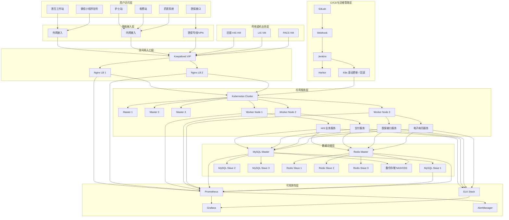

# 福州福兴妇产医院 HIS 系统架构设计方案

## 项目背景

福州福兴妇产医院是民营二级妇产医院，HIS 系统支撑预约挂号、收费结算、医保接口、药房管理等业务。随着就诊业务增长，系统访问压力上升，出现数据库性能瓶颈，同时原有架构缺少容灾能力。

核心目标：
- 优化平台稳定性，保障诊疗业务不间断
- 满足医疗行业数据安全合规要求
- 构建高可用、可扩展、可审计的本地化 IT 平台

---

## 系统整体架构图

---

## 架构分层说明

### 1. 用户访问层
- 医生工作站
- 护士站
- 收费站
- 药房系统
- 医保接口
- 微信小程序挂号

### 2. 网络接入层
- 外网接入：面向患者和医务人员的互联网入口
- 内网接入：院内局域网访问
- 医保专线 / VPN：实现与医保平台安全互联

### 3. 高可用入口层
- Keepalived：保证 VIP 自动漂移，支持主备切换
- Nginx：负责流量分发、静态资源处理、反向代理
- 采用双机热备模式，降低单点故障风险

### 4. 应用服务层
- 基于 Kubernetes 容器化部署服务组件
- 业务模块包括：
  - HIS 业务服务
  - 支付服务
  - 医保接口服务
  - 电子病历服务
- 传统虚拟机环境继续承载遗留系统（LIS、PACS、旧版 HIS）

### 5. 数据存储层
- MySQL 主从复制架构
  - Master：负责写入和关键事务处理
  - Slave：负责读流量分担、报表查询和备份
- Redis 作为缓存层
  - Session 缓存
  - 热点数据缓存
  - 访问加速
- 采用定时物理备份和异地数据存储方案

### 6. CI/CD 与运维管理层
- GitLab：代码托管与版本管理
- Jenkins：持续集成与自动化发布
- Harbor：企业级私有镜像仓库
- Webhook：实现代码提交后自动构建镜像
- Kubernetes：实现滚动更新、灰度发布和回滚

### 7. 可观测性层
- Prometheus：采集基础设施和应用指标
- Grafana：实时监控大屏和告警展示
- ELK：日志收集、聚合和分析
- AlertManager：告警规则与推送

---

## 核心设计原则

1. 高可用：采用主备切换、故障转移和自动恢复机制。
2. 稳定性：提升系统吞吐、优化数据库与缓存性能。
3. 安全合规：对医疗数据访问与审计进行集中控制。
4. 自动化：通过 CI/CD 和监控平台减少人工干预。
5. 可扩展：支持业务增长及后续融合更多医院系统。

---

## 适用场景

- 挂号业务高峰期访问优化
- 缴费结算与医保接口的稳定性提升
- 电子病历和处方流转的性能保障
- 数据恢复、容灾验证和系统演练

---

## 结论

该架构结合了本地化高可用入口、容器化应用部署、MySQL/Redis 数据层优化以及 Prometheus + ELK 全链路监控能力，能够在保障医疗业务连续性与数据安全的同时，提升系统可扩展性和运维效率。

---

## 文档结构

- [高可用架构设计](docs/ha-architecture.md)
- [容器与 Kubernetes 方案](docs/k8s-deployment.md)
- [CI/CD 流水线](docs/cicd-pipeline.md)
- [监控与日志体系](docs/monitoring-logging.md)
- [数据库与缓存设计](docs/database-cache.md)
- [备份与灾难恢复](docs/backup-recovery.md)
- [运维 SOP](docs/operation-sop.md)

---

更新时间：2026-10-06
